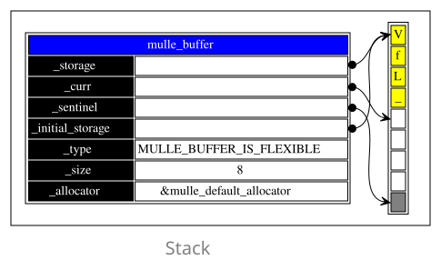
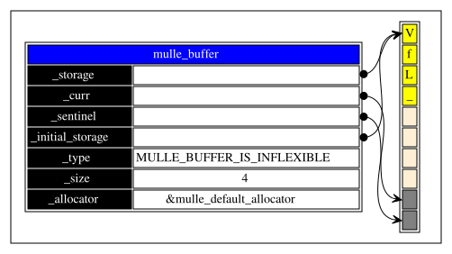
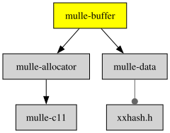

# mulle-buffer

#### ↗️  A growable C char array and also a stream - on stack and heap

`mulle-buffer` is a capable, deliberately low-level C byte builder. Its strongest
use case is producing binary or textual output with minimal ceremony: start on
stack storage, grow to heap storage when necessary, or stream bounded output to
a callback.

mulle-buffer can construct arbitrary long binary data dynamically or in static
storage. You don't have to worry about calculating the necessary buffer size.
It's easy, fast and safe. It can also be used as a stream and it is used to
implement NSMutableData. mulle-buffer has functions to create hexdumps and
quoted C string output.

With [mulle-fprintf](//github.com/mulle-core/mulle_fprintf), you can use
`printf` style formatting and create string concatenations without
having to worry about memory management.


| Release Version                                       | Release Notes  | AI Documentation
|-------------------------------------------------------|----------------|---------------
|      [](//github.com/mulle-c/mulle-buffer/actions)  | [RELEASENOTES](RELEASENOTES.md) | [DeepWiki for mulle-buffer](https://deepwiki.com/mulle-c/mulle-buffer)


## API

| Data Structure                                        | Description
| ------------------------------------------------------| ----------------------------------------
| [`mulle-buffer`](dox/API_BUFFER.md)                   | A resizable alloca buffer that grows to the heaep if needed
| [`mulle-flushablebuffer`](dox/API_FLUSHABLEBUFFER.md) | Useful for dumps and other longer output


## Documentation & Guides

* [API Summary](asset/dox/api/toc)


## Thread Safety

mulle-buffer is **not thread-safe**. A single buffer must not be accessed from
multiple threads concurrently. If you need concurrent writes, serialize access
externally (e.g. with a mutex) or use one buffer per thread.


## Examples


### Dynamic C string construction

Here a C string is constructed that is valid inside the `mulle_buffer_do`
block:


``` c
void  test( void)
{
   mulle_buffer_do( buffer)
   {
      mulle_buffer_add_string( buffer, "hello");
      mulle_buffer_add_string( buffer, " ");
      mulle_buffer_add_string( buffer, "world");

      printf( "%s\n", mulle_buffer_get_string( buffer));
   }
}
```

As soon as the `mulle_buffer_do` block is exited, the buffer will be invalid.

> #### Note
>
> A `break` inside the block is OK and does not leak, but a `return` will
> leak. Use `mulle_buffer_return` instead.


### Use explicit stack memory for small strings

`mulle_buffer_do` will create a default sized stack buffer of at least 128 bytes.

If you want to specify the amount of stack space yourself, you can use
`mulle_buffer_do_flexible`. If the stack storage is exhausted, the string will be copied
to dynamically allocated memory:


``` c
void  test( void)
{
   char   tmp[ 256];

   mulle_buffer_do_flexible( buffer, tmp, sizeof( tmp))
   {
      mulle_buffer_add_string( buffer, "hello");
      mulle_buffer_add_string( buffer, " ");
      mulle_buffer_add_string( buffer, "world");

      printf( "%s\n", mulle_buffer_get_string( buffer));
   }
}
```




If you don't want the string to ever exceed the initial storage length
you can use `mulle_buffer_do_inflexible`:

``` c
void  test( void)
{
   char   tmp[ 8];  // space for seven characters and trailing zero

   mulle_buffer_do_inflexible( buffer, tmp, sizeof( tmp))
   {
      mulle_buffer_add_string( buffer, "VfL_");
      mulle_buffer_add_string( buffer, "Bochum");

      printf( "%s\n", mulle_buffer_get_string( buffer));
   }
}
```




This should print "VfL_Boc", as the overflow preserves the pre-overflow content
and `get_string` zero-terminates the last byte.


### Convenience macro for creating allocated strings

To construct a dynamically allocated string, that you can use outside of the
`mulle_buffer_do` block, use the `mulle_buffer_do_string` convenience macro.
It's similar to `mulle_buffer_do`, but takes two more arguments.
The second argument is the allocator to use for
the string. Use NULL for the default allocator or use `&mulle_stdlib_allocator`
for the standard C allocator. The third parameter is the `char *` variable name
that will hold the resultant C string:


``` c
void  test( void)
{
   unsigned int   i;
   char           *s;

   mulle_buffer_do_string( buffer, NULL, s)
   {
      for( i = 0; i < 10; i++)
         mulle_buffer_add_byte( buffer, 'a' + i % 26);

      mulle_buffer_memset( buffer, 'z', 10);
      mulle_buffer_add_string( buffer, "hello");
   }

   printf( "%s\n", s);
   mulle_free( s);         // this time its allocated
}
```


You will have to `mulle_free` the constructed string "s".

### Permanent mulle-buffer

If the mulle-buffer should live longer than the current function, create
and destroy a buffer manually:

``` c
buffer = mulle_buffer_create_default();
...
mulle_buffer_destroy( buffer);
```

or

``` c
mulle_buffer_init_default( &buffer);
...
mulle_buffer_done( buffer);
```

> #### Tip
>
> Use the companion project [mulle-sprintf](//github.com/mulle-core/mulle-sprintf) to
> print data with format strings a la `sprintf` into a mulle-buffer.
>


### You are here




## Add

### Add mulle-buffer via mulle-core

mulle-buffer is a component of the
[mulle-core](//github.com/mulle-core/mulle-core) library.
In your code include its umbrella header:

``` c
#include <mulle-core/mulle-core.h>
```

Add mulle-core to your `CMakeLists.txt` with
[FetchContent](https://cmake.org/cmake/help/latest/module/FetchContent.html):

``` cmake
include( FetchContent)

set( MULLE__CORE_TAG "master" CACHE STRING "branch or tag to fetch mulle-core from")

FetchContent_Declare( MULLE__CORE
   GIT_REPOSITORY https://github.com/mulle-core/mulle-core.git
   GIT_TAG        "${MULLE__CORE_TAG}")
FetchContent_MakeAvailable( MULLE__CORE)

target_link_libraries( ${PROJECT_NAME} PUBLIC mulle-core)
```

Or add to your mulle-sde project with:

``` sh
mulle-sde add mulle-core/mulle-core
```


### Add mulle-buffer as a cmake subproject

In your code include its header:

``` c
#include <mulle-buffer/mulle-buffer.h>
```

Add mulle-buffer and its dependencies to your `CMakeLists.txt` with
[FetchContent](https://cmake.org/cmake/help/latest/module/FetchContent.html):

``` cmake
include( FetchContent)

include_directories( SYSTEM "${CMAKE_BINARY_DIR}/include")

set( MULLE__C11_TAG "master" CACHE STRING "branch or tag to fetch mulle-c11 from")

FetchContent_Declare( MULLE__C11
   GIT_REPOSITORY https://github.com/mulle-c/mulle-c11.git
   GIT_TAG        "${MULLE__C11_TAG}")
FetchContent_MakeAvailable( MULLE__C11)

set( MULLE__ALLOCATOR_TAG "master" CACHE STRING "branch or tag to fetch mulle-allocator from")

FetchContent_Declare( MULLE__ALLOCATOR
   GIT_REPOSITORY https://github.com/mulle-c/mulle-allocator.git
   GIT_TAG        "${MULLE__ALLOCATOR_TAG}")
FetchContent_MakeAvailable( MULLE__ALLOCATOR)

set( MULLE__DATA_TAG "master" CACHE STRING "branch or tag to fetch mulle-data from")

FetchContent_Declare( MULLE__DATA
   GIT_REPOSITORY https://github.com/mulle-c/mulle-data.git
   GIT_TAG        "${MULLE__DATA_TAG}")
FetchContent_MakeAvailable( MULLE__DATA)

set( MULLE__BUFFER_TAG "master" CACHE STRING "branch or tag to fetch mulle-buffer from")

FetchContent_Declare( MULLE__BUFFER
   GIT_REPOSITORY https://github.com/mulle-c/mulle-buffer.git
   GIT_TAG        "${MULLE__BUFFER_TAG}")
FetchContent_MakeAvailable( MULLE__BUFFER)

target_link_libraries( ${PROJECT_NAME} PUBLIC mulle-buffer)
```

Or add to your mulle-sde project with:

``` sh
mulle-sde add github:mulle-c/mulle-buffer
```

## Individual Install

Install all the prerequisites.

``` bash
PREFIX=/tmp/usr/local
BUILD_DIR="mulle-buffer/build"

cmake -S "mulle-buffer" -B "${BUILD_DIR}"    \
  -DCMAKE_BUILD_TYPE="Release"                  \
  -DCMAKE_INSTALL_PREFIX="${PREFIX}"            \
  -DCMAKE_PREFIX_PATH="${PREFIX}"               \
  -DCMAKE_C_FLAGS="-I"${PREFIX}"/include"       \
&& cmake --build "${BUILD_DIR}"  --parallel     \
&& cmake --install "${BUILD_DIR}"
```


## Author

[Nat!](https://mulle-kybernetik.com/weblog) for Mulle kybernetiK  


